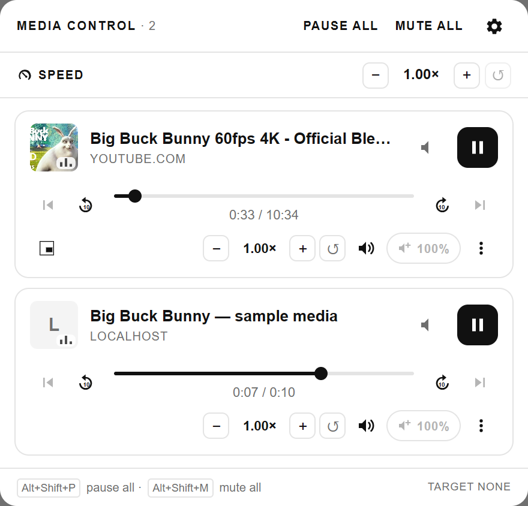
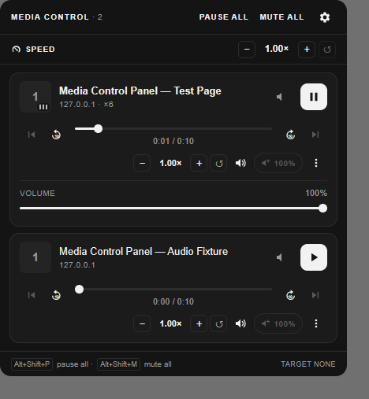

# Media Control Panel

A Chrome extension that puts every tab playing media into one toolbar popup —
Chrome's own Global Media Controls, but stronger: a global playback speed with
per-page overrides, tab volume boost up to 600 %, pause everything, mute
everything, seek, per-tab volume, Picture-in-Picture, and a keyboard command
surface. Built as pure HTML/CSS/JS: no framework, no build step, no webfonts,
nothing to compile.

Everything is local: no accounts, no analytics, no network requests, and audio
boost processing never leaves the device. Persistent state is the pinned target
and the recently-playing list (`chrome.storage.session`, cleared when the
browser closes), preferences and the global speed (`chrome.storage.local`),
and per-page speed overrides (`chrome.storage.session`, cleared on navigation
or browser exit).

| Light | Dark |
|---|---|
|  |  |

## Features (v2.1)

- **Media cards** — one rounded card per media tab: artwork (from the page's
  media session when available, favicon or letter tile otherwise), media title,
  source, live position bar with times (or a LIVE tag on streams), and every
  everyday control directly on the card — no details panel to expand.
- **Card controls** — a transport row around the seek slider (previous →
  back 10 s → position/progress → forward 10 s → next), then prominent
  play/pause (Alt+click solos the tab), previous/next track (YouTube, Spotify,
  SoundCloud — always in place, disabled where the site has no control, and
  mirroring the site's own disabled state where it exposes one), ±10 s,
  Picture-in-Picture (video only), tab mute, a volume popover (0–100 %,
  element volume), a per-page speed stepper, a tab boost chip, and an overflow
  menu (pin target, switch to tab, close tab).
- **Global speed** — a speed bar under the header: 0.25×–4.00× in 0.25× steps,
  reset to 1.00×, persisted in `chrome.storage.local`. It is the default rate
  for media across tabs — including media that starts later, new pages, and
  dynamically inserted elements. While a policy is active, the (idempotent,
  event-driven) page manager is installed into **every open, injectable tab**,
  not just tabs detected as media tabs — a silent page opened earlier still
  gets the policy, so media it inserts later inherits it. At factory defaults
  (global 1.00×, no overrides) nothing is injected or polled. Enforcement also
  stamps the element's `defaultPlaybackRate`, so a site changing sources keeps
  the policy with no event handling at all. With no policy in force the card
  shows the site's actual observed rate ("Website-set rate") instead of
  pretending 1.00×.
- **Per-page overrides** — each card's speed stepper sets a page-specific rate,
  stepping from the rate currently in effect. Overridden pages keep their rate
  when the global speed changes; a **reset** button appears on the card to
  return to global. An override is scoped to the tab's committed DOCUMENT
  identity (`webNavigation.onCommitted`'s `documentId`): it survives popup
  close/reopen and same-document transitions (pushState and hash changes), and
  is removed by any real navigation — including a hard reload of the same URL,
  which is a new document — and on tab close.
- **Native player changes are respected** — if a site's own player changes the
  playback rate (a user picking 1.5× in YouTube's menu, or site JS), the
  extension adopts that rate as the page's override instead of fighting it.
  This works for media inside iframes too: the manager runs per frame, and a
  report is validated against the committed document of the frame it came
  from (a current iframe document is accepted; a replaced one is rejected),
  while the override itself stays scoped to the tab's top-level document.
  Website-exact rates are preserved (1.10× stays 1.10×, never snapped to the
  0.25× grid).
- **Tab volume boost** — amplification from 100 % (unity) to 600 % for **the
  tab you are viewing**, built on `chrome.tabCapture` + an offscreen document
  with a Web Audio `GainNode` and a soft limiter. The capture API's documented
  rule is that a target tab must carry the `activeTab` grant (declared in the
  manifest; invoking the toolbar action grants it to the tab in front of you),
  so boost controls are enabled on that tab's card (other cards show a
  truthful disabled state). Distinct from element volume and from tab mute;
  moving the slider back to 100 % or pressing reset releases the whole
  pipeline, navigating the tab — including pushState and hash changes — stops
  the boost, and state is always truthful (no fake "active" after a browser
  restart or a vanished pipeline). Every capture start carries a per-tab
  **request id** checked after every asynchronous stage (offscreen creation,
  stream-id fetch, forwarding, `getUserMedia`, AudioContext init, graph
  build): a stop, navigation, reset or restart cancels all of them, a late
  stream is dropped (tracks stopped, no graph, no result), and stops carry the
  request id so a delayed stop from an older request can never tear down a
  restarted pipeline. An **end-to-end startup deadline** (12 s, armed when the
  request begins) converges a hung capture to a truthful error. Failure paths
  release everything: tracks, partial nodes, an unused AudioContext, pending
  state, and the offscreen document itself when no pipeline remains (the
  error state also closes it on its auto-clear).
- **Pause all / Mute all** in the header; Mute all flips to Unmute all
  contextually.
- **Pinned target** — mark one tab (accent card border) and toggle its
  playback from the keyboard without opening the popup.
- **Settings** — the gear opens three device-local toggles: **auto-pause on
  open**, the **playing-count badge**, and whether **paused media tabs stay
  listed**. Stored in `chrome.storage.local`; nothing leaves the device.
- **Keyboard** — `↑`/`↓` move between cards, `Home`/`End` jump, `←`/`→` seek
  ±10 s on the focused card. While a slider has focus, all four arrows adjust
  the slider. `Esc` closes popovers and settings. Everything also stays
  reachable with `Tab` alone.
- **Keyboard commands** (remappable at `chrome://extensions/shortcuts`):
  - `Alt+Shift+Space` — play/pause the pinned target
  - `Alt+Shift+P` — pause media in every tab that has any
  - `Alt+Shift+M` — mute all audible tabs / unmute what this extension muted
- **Playing-count badge** — the toolbar icon shows how many tabs are making
  sound, like Chrome's own media icon.
- **Dark mode** — follows the system, token swap only.

## Install (unpacked)

1. Open `chrome://extensions`, enable **Developer mode**, click **Load unpacked**, select the
   `extension/` folder.
2. **Pin the icon**: click the puzzle-piece menu in the toolbar and pin **Media Control** —
   Chrome keeps new extensions hidden behind it (this is Chrome behavior, not a bug).
3. Click the toolbar icon. For private windows also enable **Allow in Incognito** on the
   extension card.
4. Optional: `npm run icons` regenerates the icon set (pure Node, no dependencies).

Note on shortcuts: Chrome may leave a command unassigned if another app took the key
(Edge, for example, claims `Alt+Shift+P`). Check `chrome://extensions/shortcuts` — every
command is remappable there.

## Try it

`npm run serve`, open <http://localhost:8080/test/media-page.html> (two remote videos, a local
tone, a remote mp3, a cross-origin YouTube embed and a live canvas video), then open the popup.
For the UI without Chrome at all: <http://localhost:8080/test/popup-mock.html> runs the real
popup against a mock browser; <http://localhost:8080/test/background-mock.html> asserts the
command matrix plus the speed-policy and boost state machines.

- `npm test` — static checks (module syntax, manifest sanity, icons, references, and a guard
  that injected functions stay serialization-safe).
- `npm run harness` — runs both mock pages in headless Edge: 67 background assertions
  (commands, badge, speed-policy coordination including policy revisions, documentId
  scoping for SPA/reload/hash transitions and frame-aware report provenance, silent-
  tab coverage, `defaultPlaybackRate` stamping/teardown, managed tabs, and the boost
  state machine — real offscreen document logic against deferred `getUserMedia`/
  AudioContext/offscreen-create stubs, covering pending-gain updates, delayed-
  operation cancellation at every startup stage, the full-startup deadline, stale
  request ids, restarts and failure cleanup) plus a popup smoke pass.
- `npm run e2e` — launches a real Chromium browser (Edge via CDP — branded Chrome 137+ ignores
  `--load-extension`) with the unpacked extension loaded, opens the popup as an extension page,
  and drives 91 end-to-end assertions: detection, titles, play/pause/resume, exclusive playback,
  seek, volume, the global and per-page speed policy, mute, global actions, badge, pin, boost
  plumbing and gating, override persistence, adapters, keyboard navigation, settings — plus a
  16-step deterministic speed-regression matrix (test/speed-suite.html, generated 180 s tones,
  no network): global application and `defaultPlaybackRate` stamping, native-ratechange
  adoption, SPA video changes keeping the override, reset-to-global for current and future
  media, native 1.00×/1.10× respect and off-grid stepping, rapid global/page changes, media
  ending mid-command, popup reopen cycles, managed tabs outside the candidate list,
  full-navigation cleanup, same-URL reload clearing the override (documentId), hash-only
  changes keeping both the override and the applied rate, an iframe native change adopted as
  the page override (with child-frame navigation keeping the top-level override and top-level
  navigation clearing it), and a silent tab receiving global speed for dynamically inserted
  media (then returning to normal after reset).
- `npm run verify-capture` — opens a real headed Edge window and probes what the capture API
  actually allows (popup click flow, a reset → restart cycle with real mouse input, then raw
  `getMediaStreamId` checks); records the outcome without asserting it.
- `npm run shots` — regenerates the README screenshots from the real popup.

## Why it's light

While the popup is closed the extension is two sleeping event listeners (badge +
keyboard commands), plus — only when a speed policy needs enforcing — event-driven
page managers inside media tabs. There are still **no persistent content scripts in
the manifest**; the speed manager is injected on demand (`chrome.scripting`) into
media tabs **only while global speed ≠ 1.00× or a page override exists**, uses
`ratechange`/`play` listeners and a debounced MutationObserver (no polling), and
removes itself when no policy needs enforcing. At factory defaults (global 1.00×,
no overrides) the idle footprint is exactly what it was before: a sleeping worker.
The offscreen audio document for boost exists **only while at least one boost is
active** and is torn down when the last one resets.

Detection uses `tabs.query` (audible/muted need no permission), control is
on-demand `chrome.scripting.executeScript` only when you click something, and the
cards' 1-second refresh runs only while a card's media is **playing**. Total
unpacked size is about 85 KB including icons — measure with `du -sb extension`
(the whole repository, docs and test fixtures included, is under 1 MB).

Permissions, exactly:

| Permission | Why |
|---|---|
| `scripting` | inject the control functions and the conditional speed manager into media tabs |
| `storage` | settings + global speed (local); pinned target, recent list, page overrides, boost state (session) |
| `tabCapture` | capture the audio of a tab you explicitly boost, for local gain processing only |
| `offscreen` | host the offscreen audio-processing document while a boost is active |
| `activeTab` | the documented grant `tabCapture.getMediaStreamId({targetTabId})` requires on the target tab; invoking the toolbar action grants it to the viewed tab (no install-time warning) |
| `webNavigation` | tell a committed navigation (override cleared) from a same-document transition (override kept); supplies the `documentId` that scopes overrides |
| `<all_urls>` (host) | `executeScript` into arbitrary tabs; also unlocks tab titles |

No `tabs` permission — audible/muted state is free, and host permissions already unlock titles.
`webNavigation` carries Chrome's "Read your browsing history" install warning; the extension
listens only to top-frame commit/history events to scope speed overrides to the right document
and to stop boosts on SPA navigations. It stores nothing about where you browse.

**Boost privacy and targeting**: tab capture starts only from your click on a specific tab's
boost control, and the platform restricts capture targets to tabs with the `activeTab` grant —
the tab you are viewing when the popup opens (the browser enforces this; `npm run
verify-capture` records its exact refusal message otherwise). The popup's click reaches the
service worker as an extension message (gestures ride along), the worker obtains the one-time
stream id and hands it to the offscreen document — the docs-blessed consumer path. The stream
is processed through a local Web Audio graph (gain + limiter) and released on reset. Nothing is
recorded, buffered, uploaded, or shared — there are no remote endpoints at all. While a tab is
captured the browser shows its standard recording indicator; the captured tab's audio is
redirected through the graph (at 100 % gain it is unity — which is why no pipeline is ever
created at 100 %, and moving back to 100 % stops it).

## Design

International Typographic Style, softened for the card layout: an 8 px grid, hairlines,
10 px-radius cards on a 440 px stage, ink on paper with one Swiss red accent that only
ever marks meaning (the pinned target, live indicators, active overrides, active boost).
System Helvetica stack — zero font downloads. The full token set, component vocabulary
and interaction specs live in [docs/DESIGN.md](docs/DESIGN.md).

## Architecture

```
extension/
  manifest.json    MV3 — scripting+storage+tabCapture+offscreen, <all_urls>, 3 commands
  popup.html/css/js  the whole UI; exists only while open
  background.js    badge + keyboard commands + speed policy authority + boost routing
  lib/page.js      injected functions (probe/ping/toggle/pause/seek/volume/PiP)
  lib/manager.js   injected page-level speed manager (event-driven, self-removing)
  lib/speed.js     shared speed model: range/stepping/format + storage helpers
  lib/adapters.js  per-site next/prev track (YouTube, Spotify, SoundCloud)
  lib/settings.js  settings model shared by popup and background (chrome.storage.local)
  offscreen.html/js  audio boost pipeline: capture -> gain -> limiter -> output
scripts/           icon generator, static checks (npm test), harness runner, E2E rig,
                   screenshot generator
test/              chrome mock, popup harness, background harness, media fixtures
docs/              RESEARCH.md (why), DESIGN.md (look), PLAN.md (roadmap), CHECKLIST.md (manual pass)
```

**Speed precedence** (single source of truth in `lib/speed.js`, enforced by the
background worker, normative invariants R1–R7 in [docs/DESIGN.md](docs/DESIGN.md)):
a page without an override inherits the global speed; changing the global speed
updates every inheriting page; an overridden page keeps its rate; a page-originated
`ratechange` away from the inherited rate becomes the page's override; a change
landing exactly on the global rate is inheritance; resetting a page re-applies
global — including to paused media — and is atomic against in-flight stale reports
(per-tab policy revisions). Extension-initiated steps move in exact 0.25×
increments from the rate in effect; website rates are preserved exactly.

See [docs/RESEARCH.md](docs/RESEARCH.md) for how Chrome's Global Media Controls works,
how tab capture + offscreen processing is meant to be wired, and why this extension
is built the way it is.

## Known limits

- Media inside closed shadow roots, DRM-protected pages and WebAudio-only playback can't be
  reached by any extension in this category (Chrome's internal media session service is not
  exposed to extensions).
- Next/previous track only exists on sites with an adapter (YouTube, Spotify, SoundCloud); other
  sites expose no next/prev control an extension could drive.
- `chrome://` pages can be listed and muted but not play/paused, speed-managed, or boosted —
  they are not injectable and cannot be captured.
- The speed manager enforces the policy blindly on **playing** media; a paused element takes
  the policy when it is untouched (at 1.00× or extension-set) and keeps a foreign rate until it
  plays (then it is adopted or applied). A reset or a page-speed command reaches paused media
  directly; a plain global change does not clobber a paused element's site-set rate.
- A page-originated rate change is adopted whatever its origin (user menu or site JS) — the
  browser does not expose intent. A site re-applying the rate last chosen in its own menu on a
  later video is indistinguishable from a live user choice and is adopted the same way. The card
  always shows what actually happened (override / website-set / inheriting); the reset button is
  always one click away.
- MediaStream-backed elements (`srcObject` live previews) cannot hold an arbitrary playbackRate —
  Chromium clamps the write — so the manager skips them entirely.
- Boost gain is per-tab and multiplicative with element volume and tab mute: muting the tab
  mutes the boosted output too. High boost levels can distort; a limiter tames but does not
  eliminate it.
- While a tab is captured, the browser shows its recording indicator — that is how
  `tabCapture` works, for every extension in this category. Boost targets are limited to the
  viewed tab (the platform's `activeTab` rule); navigating the boosted tab stops the boost.
